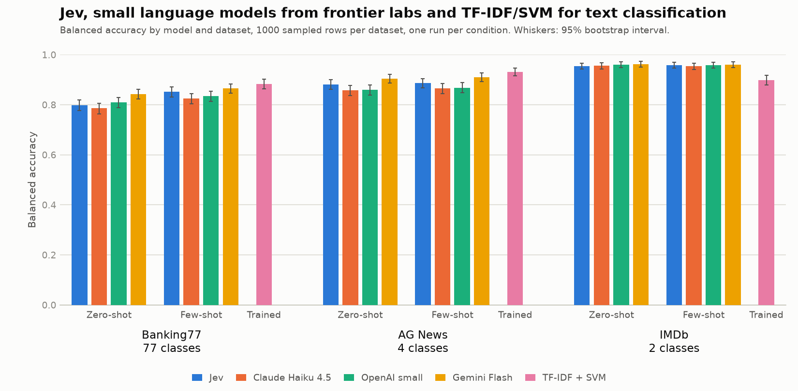

**TL;DR.** Across 1,000 samples from each of three public text classification datasets, Jev matched or beat Claude Haiku 4.5 and GPT-5.4 mini on balanced accuracy, and trailed Gemini 3.8 Flash by 2 to 4 points on AG News and zero-shot Banking77. At list price, it costs between ~2 and ~15 times less per row than the cheapest LLM. Despite being trained using Reinforcement Learning for Calibrated Decisions, its confidence values were not better calibrated than the LLMs' self-reported confidence: Jev's expected calibration error (ECE) ranked third of four on every dataset. Accuracy did rise with Jev's confidence, so a confidence threshold was still useful. A TF-IDF + linear SVM trained on the full training splits had the highest balanced accuracy on Banking77 and AG News, but was about 6 points behind every API model on IMDb.

## Background

[Jev](https://typesafe.ai/blog/introducing-system-one-models-and-jev) is a language model from TypeSafe AI, announced in September 2026. It does not generate text and is effectively a classifier. You send it some text (the 'state') and typed questions: a yes/no question (returned as a probability), a choice between labelled options, or a score on a described scale. Every answer comes with a probability per option and a `confidence` value. TypeSafe says it trained Jev with Reinforcement Learning for Calibrated Decisions (RLCD), and describes the result as 'Calibrated: higher confidence means higher accuracy'.

Like an LLM, Jev can be used zero-shot or with a few labelled examples in the request. In this comparison the examples helped on Banking77 but made no clear difference on AG News or IMDb.

Jev also has a feature that an LLM call does not: batching multiple typed questions about the same text in one request. In a quick test (one support thread, five questions, three repeats), one request took 0.46 s and 795 input tokens, against 2.06 s and 3,015 tokens for five separate requests, with the same answers to within 0.01. Jev is already low-cost, and further savings can be made through batching.

I wanted to answer two questions:

- How does a model built only for classification compare with the cheap end of general-purpose LLMs on text classification tasks?
- How well does its 'calibrated' confidence track `P(correct)`? Is it reliable enough to act on, for example to send low-confidence items to a person? LLMs will also give you a confidence if requested ('verbalised confidence'), but it is a number written out as text, and it is often overconfident.

## Method

### Models

I ran Jev against the small, fast model from each of three providers, chosen so that the comparison is between models of similar price and speed:

- Jev: `typesafe-ai/jev` through the Vercel AI Gateway. The gateway exposes no version string, so this means the model as served on 20 and 21 September 2026, within a week of its 15 September release.
- Claude Haiku 4.5: `claude-haiku-4-5-20251001`, temperature 0, no extended thinking.
- GPT-5.4 mini: `gpt-5.4-mini` (returned as `gpt-5.4-mini-2026-03-17`), reasoning effort `none`.
- Gemini 3.8 Flash: `gemini-3.8-flash`, temperature 0, thinking budget 0.

As a reference point I also trained a TF-IDF + linear SVM (words and word pairs as features) on each full training split, with `C` chosen by 5-fold cross-validation.

### Datasets

The datasets were:

- Banking77 (77 fine-grained banking intents)
- AG News (4 news topics)
- IMDb (binary sentiment)

Each test set was a stratified sample of 1,000 rows from the official test split (seed 0), the same rows for every model. The design loosely follows an independent [Jev vs. classical ML](https://quicqdev.github.io/Jev-vs-ML/) benchmark by QuicqDev Research, keeping its metric (balanced accuracy, the mean of per-class recall) and its few-shot setup (one example per class).

## Accuracy

Comparing models row by row on the same samples:

- Against Haiku and GPT-5.4 mini, Jev was 1.8 to 2.3 points ahead on AG News in both conditions, and 1.7 to 2.7 points ahead on few-shot Banking77. Zero-shot Banking77 and IMDb were level, with intervals that included zero.
- Gemini was ahead of Jev by 4.4 points on zero-shot Banking77 (0.843 against 0.799) and by 2.4 to 2.5 points on AG News. On few-shot Banking77 and on IMDb the differences were within noise.
- On IMDb all four API models scored between 0.954 and 0.962.

Few-shot examples helped every model on Banking77 (Jev gained 5.3 points, the LLMs 2.2 to 3.9) and made no clear difference on the other two datasets.

The SVM, trained on the full training split, was the most accurate on Banking77 (0.884) and AG News (0.932), 3 to 8.5 points above Jev. On IMDb it was about 6 points below every API model (0.899). It also had far more labelled data than anything else here: 10,003 to 120,000 training rows against one example per class. The reason to pick Jev or an LLM over a trained classifier here would be lack of labelled data.

## Calibration

For calibration I used the zero-shot runs and the rows all four models answered (994 on IMDb, where Gemini failed on six). ECE is the gap between stated confidence and accuracy within confidence buckets of width 0.1 (below 0.5 grouped together), weighted by bucket size. The Brier score is the mean squared difference between confidence and correctness, over every row. Lower is better for both.

| Dataset | Measure | Jev | Haiku 4.5 | GPT-5.4 mini | Gemini 3.8 Flash |
|---|---|---|---|---|---|
| Banking77 | ECE | 0.115 | **0.094** | 0.139 | 0.109 |
| | Brier | **0.129** | 0.151 | 0.156 | 0.131 |
| AG News | ECE | 0.084 | 0.051 | 0.106 | **0.033** |
| | Brier | 0.101 | 0.114 | 0.120 | **0.077** |
| IMDb | ECE | 0.028 | 0.029 | **0.009** | 0.013 |
| | Brier | 0.035 | 0.036 | 0.033 | **0.030** |

Jev was third of four on ECE on every dataset. On IMDb all four were close to calibrated, because nearly every answer was confident and right. On Banking77 and AG News all four were overconfident in the top bucket, which held most rows. On Banking77, Jev's mean confidence was 0.91 and its accuracy 0.80.

### Brier score

The Brier score tells a slightly different story. Jev had the lowest on Banking77, although Gemini's was within 0.002 and the difference included zero. ECE only measures whether confidence matches accuracy within each bucket. The Brier score also rewards confidence that separates right answers from wrong ones. Jev's Brier score was lower than Haiku's and GPT-5.4 mini's on both Banking77 and AG News, with intervals that excluded zero, despite a worse ECE than Haiku on both. This suggests Jev's confidence separated right from wrong answers better than those two models' did, although I didn't measure that directly.

### Confidence thresholds

The weaker reading of TypeSafe's claim, that higher confidence means higher accuracy, held for Jev in one sense: keeping only answers at or above a confidence threshold raised accuracy as the threshold rose. On Banking77 it went from 0.799 with no threshold to 0.935 at 0.95, keeping 70% of rows. On IMDb the rise was smaller (0.955 to 0.977) and flat between thresholds of 0.45 and 0.6. The same was true of all three LLMs, so this does not set Jev apart. Individual low-confidence buckets, with 3 to 73 rows each, were too noisy to say more. The stricter reading, that a stated 0.9 means right nine times in ten, did not hold any better for Jev than for the LLMs.

## Cost and latency

Cost per 1,000 rows, zero-shot, from the tokens actually used, at list prices with prompt caching where the provider applied it:

| Dataset | Jev | Haiku 4.5 | GPT-5.4 mini | Gemini 3.8 Flash |
|---|---|---|---|---|
| Banking77 | \$0.101 | \$2.82 | \$0.334 | \$0.330 |
| AG News | \$0.020 | \$0.505 | \$0.270 | \$0.234 |
| IMDb | \$0.027 | \$0.695 | \$0.406 | \$0.381 |

Across all six dataset and shot combinations Jev was 2.3 to 15.4 times cheaper than the cheapest LLM, which was Gemini each time. The smallest gap is few-shot Banking77, where the 77 examples make Jev's input long and the LLMs get most of that input from their prompt caches. TypeSafe lists input at \$0.042 per million tokens and output as free. Jev returns a probability for every label, so it produced about 830 output tokens per row on Banking77, but those cost nothing. The Vercel gateway charged my account nothing during the introductory period; the figures above use the list price it reports (`marketCost`).

Zero-shot median latency per call was 0.30 to 0.32 s for Jev, 0.76 to 0.80 s for Haiku, 0.81 to 0.89 s for GPT-5.4 mini and 1.03 to 1.21 s for Gemini. Jev went through the gateway and the LLMs were called directly, so this compares routes as well as models.

## Takeaways

For a labelling or routing step where there is little or no labelled data, Jev looks like a reasonable replacement for a small LLM. It is as accurate as two of the three and much cheaper than all of them. I would still pick thresholds from a labelled sample for the task in hand rather than trusting the stated confidence as a probability. Higher confidence did go with higher accuracy on these datasets, but it was not calibrated in the strict sense. If labelled data is plentiful, a trained classifier is still hard to beat on accuracy for topic and intent tasks.

## Reproducibility

Code, prompts, label descriptions, every raw response and all summary tables are in [4OH4/jev-compare at commit `8ea4d67`](https://github.com/4OH4/jev-compare/tree/8ea4d67156f7300094c7598f04210d3fea98c9a0). The benchmark run was made on 21 September 2026 (UTC) from commit `e6719cc` with uncommitted changes. Each results file records a hash of the code that produced it.

Python 3.13 with uv. Key packages: anthropic 1.7.0, openai 3.16.2, google-genai 2.24.0, httpx 0.28.1, scikit-learn 1.9.1, pandas 3.0.6, numpy 2.5.3, datasets 5.0.1.
